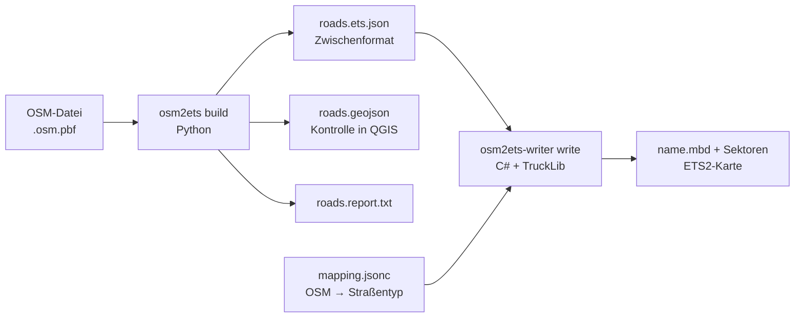

# osm2ets – OpenStreetMap → Euro Truck Simulator 2

**Deutsch** · [English](README.md)

Erzeugt aus OpenStreetMap-Daten ETS2-Kartendateien in wählbarem Maßstab (Standard 1:1)
und in Detailstufen. Die gröbste Stufe enthält nur das Fernstraßennetz – in Deutschland
Autobahnen und Bundesstraßen – plus Rampen und die anschließenden Straßen bis zur
nächsten Kreuzung.



## Stand (Oktober 2026) – bitte zuerst lesen

Frühe Entwicklungsversion. Im Spiel getestet mit ETS2 1.61 (Linux, Proton) an einem
Ausschnitt bei Bayreuth (A 9, A 70, B 85); größere Gebiete sind nicht getestet.

| Bereich | Stand |
|---|---|
| Straßennetz L1–L4 aus OSM, Maßstab 1:N, fester Ursprung | umgesetzt, getestet |
| Echte Straßenvorlagen (ger13/ger16 Autobahn, ger2 Rampe, ger1/ger5/ger9/ger29) | umgesetzt, im Spiel befahrbar |
| Durchgehende Straßen an Knoten verbunden, keine unsichtbaren Wände | umgesetzt, im Spiel geprüft |
| Autobahn-Ausfahrt/-Einfahrt mit Prefabs (2 Spuren, Rampe rechts) | umgesetzt, Verkehr fährt darüber |
| Ebenerdige T-/X-Kreuzungen mit Prefabs | umgesetzt (v7), nur ein Teil der Kreuzungen, siehe unten |
| Höhen aus Geländemodell, Brücken, Tunnel | umgesetzt (v8), im Spiel noch nicht geprüft – siehe „Bekannte Probleme" |
| 3-spurige Anschlussstellen, Rampen links, Autobahnkreuze/-dreiecke | noch nicht |
| Brückenbauwerke (Modelle), Gelände flächig, Vegetation, Städte, Firmen | noch nicht |
| Ganz Deutschland | nicht getestet (Laufzeit, Speicher, Editor-Grenzen unbekannt) |

### Bekannte Probleme (aus dem Spieltest)

- **Höhen:** Mit `--dem` (z. B. Copernicus GLO-30) folgen die Straßen dem Gelände.
  Weil Copernicus ein Oberflächenmodell ist (Bäume, Gebäude), wird zuerst ein bodennahes
  Perzentil entlang der Straße genommen, dann geglättet; an Knoten treffen sich alle
  Straßen auf derselben Höhe, und die Steigung wird netzweit auf `terrain_max_grade`
  (6 %) begrenzt. Anschlussstellen-Prefabs werden entsprechend geneigt, Kreuzungs-Prefabs
  bleiben waagerecht. Gelände gibt es weiterhin nur als Streifen neben der Straße
  (4–30 m) – dahinter ist nichts. Wo Rampen, Anschlussstraßen und Kreuzungen
  unterschiedlich hoch liegen, entstehen Stufen und Durchdringungen.
- **Kreuzungen ohne Prefab** (im Testgebiet 32 von 46): Straßenstück zwischen zwei
  nahen Kreuzungen zu kurz, Einbahn-Rampe beginnt am Seitenarm (TruckLib kann an
  Prefab-Knoten 0 nur ein Straßenende anschließen), oder Winkel > 40° von T/X (Y-Formen).
  Dort liegen die Straßen weiter übereinander.
- Knotenhäufungen an Autobahndreiecken werden noch nicht als Ganzes behandelt.
- Die Kreuzungs-Prefabs sind „narrow"-Vorlagen; Breitensprünge zur Straße sind möglich.
- **Überlagerungsprüfung:** Nur Brücken oder Tunnel dürfen sich mit einer anderen Fahrbahn
  überlagern. Der Writer meldet jeden Verstoß (`<eingabe>.overlaps.geojson`), kürzt Abzweige
  ohne Prefab bis zum Rand der anderen Fahrbahn und lässt je Knoten nur eine durchgehende
  Verbindung bestehen.
- TruckLib berechnet keine Bounding-Boxes: im Editor immer „Map → Recompute map".

## Voraussetzungen

- Python ≥ 3.10
- .NET 10 SDK (TruckLib 0.5.1 zielt auf .NET 10). Auf Ubuntu 24.04-basierten Systemen
  liegt `dotnet-sdk-10.0` in den Paketquellen (`sudo apt install dotnet-sdk-10.0`).
- ETS2 **1.59–1.61**: TruckLib 0.5.1 schreibt nur Kartenformat 907. Nach einem
  Spielupdate mit neuem Kartenformat braucht es eine neue TruckLib-Version.
- Optional: `osmium-tool` zum Zuschneiden großer OSM-Dateien, `rasterio` für Geländemodelle.

## Installation

```sh
python3 -m venv .venv && . .venv/bin/activate
pip install .              # oder: pip install '.[dem,test]'
dotnet build writer/Osm2Ets.Writer -c Release
```

## Ablauf

### 1. OSM-Daten holen und zuschneiden

Länder- und Bundeslanddateien gibt es z. B. bei Geofabrik (download.geofabrik.de).
Für den Anfang einen kleinen Ausschnitt nehmen:

```sh
osmium extract -b 11.48,50.02,11.62,50.06 bayern-latest.osm.pbf -o test.osm.pbf
```

### 2. Zwischenformat erzeugen

```sh
osm2ets build -i test.osm.pbf -o build/test --lod L1 \
    [--bbox minLon,minLat,maxLon,maxLat] [--dem gelaende.tif] [--scale 1]
```

Ergebnis: `roads.ets.json`, `roads.geojson` und `roads.report.txt`. Die GeoJSON-Datei
zeigt genau die Geometrie, die ins Spiel geht, aufgeteilt in Abschnitte gleicher
Attribute – in QGIS nach `role` einfärben (`core` = Kernnetz, `link` = Rampe,
`connector` = Anschlussstraße) oder nach `bridge`/`tunnel`. Der Bericht nennt u. a.
die größte Lageabweichung von OSM und alle höhenfreien Kreuzungen mit zu wenig Abstand.

### 3. Straßentypen festlegen

```sh
writer/Osm2Ets.Writer/bin/Release/net10.0/osm2ets-writer looks --game "<ETS2-Spielordner>" --filter ger
```

listet die Straßentypen (`road_look`) aus den `.scs`-Archiven des Spiels. Die passenden
Namen in `writer/Osm2Ets.Writer/mapping.jsonc` eintragen. Einbahn-Straßen (z. B. jede
Autobahn-Richtungsfahrbahn) werden in Fahrtrichtung geschrieben, also vom roten zum
grünen Knoten. Ob eine gewählte Vorlage diese Richtung erwartet, im Editor prüfen.

### 4. Karte schreiben

```sh
osm2ets-writer write --input build/test/roads.ets.json \
    --out "<ETS2-Benutzerordner>/mod/user_map/map" --name osm_test --verify
```

Benutzerordner laut TruckLib-Doku unter Windows `Dokumente\Euro Truck Simulator 2`;
unter Proton (Linux) im Wine-Präfix:
`steamapps/compatdata/227300/pfx/drive_c/users/steamuser/Documents/Euro Truck Simulator 2`. Der Writer legt je Sektor eine leere `.layer`-Datei an – das SCS-Wiki
nennt fünf Pflichtdateien je Sektor, TruckLib schreibt `.layer` nur bei Bedarf.

Rückgabewerte: 0 = alles geschrieben, 1 = geschrieben, aber Straßen übersprungen
(Warnungen), 3 = Prüfung mit `--verify` fehlgeschlagen, 4 = nichts geschrieben.

Schritte 2 und 4 in einem: `scripts/build_map.sh test.osm.pbf osm_test --lod L1`.

### 5. Im Editor öffnen und testen

Laut SCS-Modding-Wiki: Spiel mit dem Startparameter `-edit osm_test` starten (optional
`-noworkshop`), dann **Map → Recompute map** (TruckLib berechnet keine Bounding-Boxes),
speichern, mit **Run Map** losfahren. Alternativ im normalen Spiel über die Konsole
`preview osm_test`.

Startpunkt für Run Map: Mitte der längsten Autobahnfahrbahn, nicht auf einer Brücke.

## Detailstufen (Profil `de`)

| Stufe | Kernnetz | Anschlussstraßen (bis zur nächsten Kreuzung) |
|---|---|---|
| L1 | motorway, trunk, Bundesstraßen (B-Nummer im `ref`), Rampen | primary … living_street |
| L2 | + alle primary, secondary, tertiary (Landes-/Staats-, Kreisstraßen) | unclassified, residential, living_street |
| L3 | + unclassified, residential, living_street | service |
| L4 | + service (z. B. Rastanlagen) | – |

„Kreuzung" heißt: ein Knoten, an dem sich mindestens drei Straßenstücke der Klassen
dieser Stufe treffen (Kern, Rampen, Anschlussklassen). Alles andere zählt nicht – also
weder Feld-, Fuß- und Radwege noch `access=private`/`no`, in L1/L2 auch keine
`service`-Wege, in L3/L4 keine Parkplatzgassen und Grundstückszufahrten.
Die Tiefe (`connectors.depth`) ist im Profil einstellbar.

Bundesstraßen werden an der B-Nummer erkannt, weil `primary` in OSM nur meistens
Bundesstraße bedeutet.

## Maßstab und Koordinaten

- Projektion `EPSG:25832` (ETRS89/UTM 32N), fester Ursprung = Mittelpunkt Deutschlands.
  Getrennt erzeugte Teilgebiete passen dadurch später aneinander.
- Spielachsen: x = Osten, z = Süden (Norden = −z), y = Höhe; Sektoren 4 × 4 km.
- Der Bericht nennt den größten Koordinatenbetrag und die Float32-Auflösung dort
  (Testgebiet bei Bayreuth: ~130 km vom Ursprung → ~8 mm). Ob die Engine bei mehreren
  hundert Kilometern sauber bleibt, ist ungeklärt – das ist ein Punkt für den Spieltest.
- `--scale N` skaliert die Lage, Höhen standardmäßig gleich (Steigungen bleiben).
  Brückenhöhen und Rampen gelten in Spielmetern, weil Fahrzeuge immer 1:1 sind.
  **Bei 1:19 passen Anschlussstellen geometrisch nicht mehr** (Rampen zu kurz); der
  Bericht meldet das als Kreuzungen mit zu wenig Höhenabstand. Außerdem fallen Stücke
  unter 1,25 Spielmetern weg (bei 1:19 alles unter ~24 m in echt). Für skalierte Karten
  bräuchte es eine Generalisierung, die es noch nicht gibt.

## Höhen, Brücken, Tunnel (Heuristik)

Gerechnet wird auf einem gemeinsamen Graphen aller Straßen; an einem OSM-Knoten haben
alle Straßen dieselbe Höhe.

1. Gelände entlang der Straße aus dem Geländemodell (`--dem`, GeoTIFF/VRT): bodennahes
   Perzentil (25 %, Fenster 60 m), dann geglättet (Fenster 120 m); Steigung netzweit
   höchstens `terrain_max_grade` (6 %). Ohne Modell liegt alles auf Höhe 0.
2. Brücken ab `min_bridge_length_m` (8 m, kürzere sind meist Durchlässe) werden um
   `bridge_clearance_m × layer` angehoben (Standard 6,5 m). Die Anhebung fällt entlang
   des Netzes mit höchstens `max_ramp_grade` (5 %) ab – so entstehen Rampen, auch über
   Kreuzungen hinweg. Das gilt auch für Brücken über Flüsse oder Bahnstrecken, die in der
   Karte (noch) nicht vorkommen.
3. Jedes zusammenhängende Bauwerk wird als Ganzes zwischen seinen Widerlagern bzw.
   Portalen interpoliert – auch wenn darin eine Rampe einmündet. Brückendecks hängen
   dadurch nicht ins Tal, Tunnel steigen nicht über den Berg. Im Datenausschnitt
   abgeschnittene Bauwerksenden übernehmen die Höhe ihres Nachbarn.
4. Kreuzen sich zwei Straßen ohne gemeinsamen Knoten mit weniger als 6,5 m Abstand:
   Liegt unten ein Tunnel, wird er abgesenkt; sonst wird die obere angehoben (Rangfolge:
   höhere `layer`, dann Brücke, dann aktuelle Höhe, dann Rampe), höchstens
   `max_bridge_levels` Ebenen.

Das ist eine Näherung aus OSM-Tags, keine Vermessung. Im Testgebiet (Dreieck
Bayreuth/Kulmbach) haben danach alle 10 höhenfreien Kreuzungen ≥ 6,4 m Abstand;
eine Überführung wurde dafür auf 10,6 m angehoben. Die Vereinfachung kann Steigungen
stellenweise leicht erhöhen (Testgebiet: 5,2 % statt 5 %). Straßen, die nur durch
Schritt 4 angehoben wurden, sind im Zwischenformat nicht als Brücke markiert (die
Zuordnung lässt dort also Gelände stehen).

Stücke zwischen zwei Kreuzungen, die kürzer als die Wunschlänge von 5 m sind, werden als
ein einzelnes Straßenstück geschrieben, solange sie das Spielminimum von 1,25 m erreichen;
noch kürzere stehen im Bericht unter `qa.dropped_short_pieces`.

## Zwischenformat (`osm2ets/intermediate`, Version 1)

- `roads[]`: `points` (Spielkoordinaten), `runs` (Attributabschnitte: `highway`, `role`,
  `oneway`, `lanes`, `bridge`, `tunnel`, `layer`, `ref`, `maxspeed`, `osm_ways`),
  `start`/`end` (OSM-Knoten oder `cut` am Rand).
- `junctions[]`: Knoten mit allen angrenzenden Straßenenden und deren Richtung –
  Grundlage für die geplanten Kreuzungs-Prefabs.
- `qa.low_clearance_crossings`: höhenfreie Kreuzungen mit < 4,5 m Abstand.

## Tests

```sh
python3 -m pytest                                   # 41 Tests, synthetische Netze
OSM2ETS_REAL_EXTRACT=north-bayreuth.osm.gz python3 -m pytest -k real
dotnet run --project writer/Osm2Ets.Writer.Tests    # 10 Writer-Tests: Zuordnung, Prüfung, Speichern/Laden, Verbinden
```

Als echter Ausschnitt dient die OSM-Testdatei `core/files/north-bayreuth.osm.gz`
aus dem GraphHopper-Repository (A 9, A 70, B 85).

Hinweis zu TruckLib 0.5.1: Beim Anhängen wird kein Sektor für den Mittelpunkt des neuen
Stücks angelegt, und `Map.Save` schreibt nur angelegte Sektoren. Ein Stück, dessen
Mittelpunkt in einem Sektor ohne Knoten liegt, ginge sonst beim Speichern still verloren.
Der Writer legt diese Sektoren selbst an; ein Regressionstest deckt das ab.

## Prefabs (Anschlussstellen und Kreuzungen)

Mit `--game <ETS2-Spielordner>` (oder entpackten `.ppd`-Dateien in `--prefab-dir`) setzt
der Writer SCS-Prefabs ein. Die Spieldateien werden nur gelesen, nicht mitgeliefert.
Einzelne Dateien lassen sich mit `osm2ets-writer extract --game … --paths liste.txt --out …`
aus den `.scs`-Archiven kopieren.

- Ausfahrt: Aufweitung 2→3 (`ger_hw2-hw2_exit_mirrored_tmpl_v02`) + Teilung 3→2+1
  (`ger_hw2_exit_joint_mirrored_tmpl_v02`); Einfahrt spiegelbildlich.
- Kreuzungen: `ger_r1_x_r1_t_narrow_tmpl` (T), `ger_r1_x_r1_narrow_tmpl` (X), für
  vierspurige Straßen (ger29) die `ger_r2_no_offset_x_r1_narrow*`-Varianten.
- Knotenrollen und Richtungen stammen aus den `.ppd`-Dateien, Varianten/Looks aus den `.pmd`.
  Der Writer dreht jedes Prefab so, dass seine Arme möglichst auf den OSM-Straßen liegen,
  kürzt die Straßen und führt sie gerade in die Prefab-Knoten ein.

## Nächste Ausbaustufen

1. Flächiges Gelände zwischen den Straßen (Terrain-Items aus dem Geländemodell),
   geneigte Kreuzungs-Prefabs.
2. Restliche Kreuzungen: kurze Stücke zusammenfassen, Y-Prefabs, alternative T-Prefabs
   für Einbahn-Seitenarme, Kreisverkehre.
3. 3-spurige Anschlussstellen, Rampen links, Spurwechsel ohne Rampe, Autobahnkreuze.
4. Brückenmodelle, Gelände/Vegetation aus OSM-Landnutzung.
5. Größere Gebiete: Laufzeit und Speicher für ein Bundesland bzw. ganz Deutschland messen.

## Lizenzen

- Python-Teil (`osm2ets/`, `tests/`, `scripts/`): GPL-3.0-or-later (`LICENSE`).
- Writer (`writer/`): GPL-2.0-or-later (`writer/LICENSE`), weil TruckLib unter
  „GPL v2" steht, ohne „or later". GPL-3.0-Code dürfte nicht mit GPL-2.0-only-Code
  zusammen verbreitet werden. Das ist eine Einschätzung, keine Rechtsberatung.
- Kartendaten: © OpenStreetMap contributors, ODbL 1.0 (openstreetmap.org/copyright).
  Eine daraus erzeugte Karte braucht diese Namensnennung. Ob eine verteilte ETS2-Karte
  als „Produced Work" oder als abgeleitete Datenbank (dann Share-Alike) gilt, ist hier
  nicht verbindlich geklärt.
