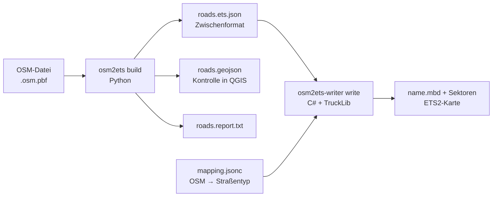

# osm2ets – OpenStreetMap → Euro Truck Simulator 2

**Deutsch** · [English](README.md)

Erzeugt aus OpenStreetMap-Daten ETS2-Kartendateien in wählbarem Maßstab (Standard 1:1)
und in fünf Detailstufen. Die gröbste Stufe enthält nur Autobahnen und Kraftfahrstraßen
mit ihren Rampen, dazu kurze Verbindungsstücke, Notfallbuchten und die Zufahrten zu
nahen Industrie- und Gewerbegebieten.



## Stand (Oktober 2026) – bitte zuerst lesen

Frühe Entwicklungsversion. Getestet im Editor von ETS2 1.61 (Linux, Proton) an einem
Ausschnitt bei Bayreuth (A 9, A 70, B 85); größere Gebiete sind ungetestet. Testkarten
v1–v46 (siehe Commits).

| Bereich | Stand |
|---|---|
| Straßennetz L1–L5 aus OSM, Maßstab 1:N, fester Ursprung | umgesetzt, getestet |
| Echte Straßenvorlagen (ger13/ger16 Autobahn, ger2 Rampe, ger1/ger5/ger9/ger29) | umgesetzt, im Spiel befahrbar |
| Durchgehende Straßen an Knoten verbunden, keine unsichtbaren Wände | umgesetzt, im Spiel geprüft |
| Autobahn-Aus-/Einfahrt mit Prefabs (2 Spuren, Rampe rechts) | umgesetzt, im Editor geprüft |
| Ebenerdige T-/X-/Gabel-Kreuzungen mit Prefabs | umgesetzt, 39 von ~46 im Testgebiet |
| Höhen aus Geländemodell, Brücken, Tunnel, `maxheight` | umgesetzt, an einer Kreuzung mit Street View abgeglichen |
| Flächiges Gelände zwischen den Straßen aus dem Geländemodell | umgesetzt, Lücken bleiben (siehe unten) |
| 3-spurige Anschlussstellen, Rampen links, Autobahnkreuze/-dreiecke | noch nicht |
| Brückenmodelle, Bewuchs/Landnutzung, Städte, Firmen | noch nicht |
| Ganz Deutschland | nicht getestet (Laufzeit, Speicher, Editor-Grenzen unbekannt) |

### Flächiges Gelände

Mit `--dem` enthält das Zwischenformat ein `terrain_grid` (10-m-Zellen, bodennah gefiltert,
bis 24 m neben einer Straße auf Straßenhöhe, bis 110 m weich ins Gelände). Der Writer füllt
den Raum zwischen den Straßen mit Terrain-Items in West-Ost-Reihen (40 m, dazu feinere Reihen
bis 1 m für Reste an Straßen). Höhenpunkte folgen dem Raster quer über jeden Streifen. Die
Freifläche berücksichtigt die echten Fahrspuren gesetzter Prefabs (Navigationskurven aus der `.ppd`).

Erkenntnisse aus Editor-Tests (nützlich für Weiterarbeit):
- Höhenpunkte (vertex offsets) sind **absolute** Lagen (Zeilenabstände 1,1,1,2,6,6,10,10,10,20,40,50… m),
  keine Verschiebungen. Beim Straßengelände zählen sie ab **Straßenmitte** entlang der Straße.
- `QuadData.Cols`/`Rows` zählen **Quads**; die Eckpunkte laufen 0..Cols und 0..Rows (mit der SCS-Originalkarte abgeglichen). Fehlte die letzte Spalte, entstand an jedem Stückende eine Wand.
- Höhenpunkte des Straßengeländes stehen in **Weltachsen** ab dem Anfangsknoten, Lage entlang der Hermite-Kurve des Spiels (wie in der SCS-Karte); damit funktioniert breites Straßengelände (60 m) auch in Kurven.
- Nach `Prefab.Attach` müssen die Knotendrehungen ohne Rollen neu gesetzt werden – sonst ist
  das erste Straßenstück verdreht und sein Rand klappt nach unten (Ursache der „kaputten" Ausfahrten).

### Bekannte Probleme

- Lücken (schwarz im Editor) bleiben in schmalen Zwickeln zwischen Rampe und Hauptfahrbahn
  und an manchen Prefabs; die Füllreihen laufen West-Ost und folgen schrägen Lücken nicht genau.
- Wo eine untergeordnete Straße unter einer Autobahn abgesenkt wird, fehlt noch die Einschnittsböschung.
- Kreuzungen ohne Prefab: Straßenstück zwischen zwei Kreuzungen zu kurz oder Winkel mehr als
  40° von T/X entfernt. Dort überlagern sich die Straßen weiterhin.
- Knotenhäufungen an Autobahndreiecken werden noch nicht als Ganzes behandelt.
- **Überlagerungsprüfung:** Nur eine Brücke oder ein Tunnel darf eine andere Fahrbahn überlagern.
  Der Writer meldet jeden Verstoß (`<input>.overlaps.geojson`).
- TruckLib berechnet keine Bounding-Boxes: im Editor immer „Map → Recompute map" ausführen.

## Voraussetzungen

- Python ≥ 3.10
- .NET 10 SDK (TruckLib 0.5.1 zielt auf .NET 10). Auf Ubuntu 24.04-basierten Systemen
  liegt `dotnet-sdk-10.0` in den Paketquellen (`sudo apt install dotnet-sdk-10.0`).
- ETS2 **1.59–1.61**: TruckLib 0.5.1 schreibt nur Kartenformat 907. Nach einem
  Spielupdate mit neuem Kartenformat braucht es eine neue TruckLib-Version.
- Optional: `osmium-tool` zum Zuschneiden großer OSM-Dateien, `rasterio` für Geländemodelle.

## Installation

```sh
python3 -m venv .venv && . .venv/bin/activate
pip install .              # oder: pip install '.[dem,test]'
dotnet build writer/Osm2Ets.Writer -c Release
```

## Ablauf

### 1. OSM-Daten holen und zuschneiden

Länder- und Bundeslanddateien gibt es z. B. bei Geofabrik (download.geofabrik.de).
Für den Anfang einen kleinen Ausschnitt nehmen:

```sh
osmium extract -b 11.48,50.02,11.62,50.06 bayern-latest.osm.pbf -o test.osm.pbf
```

### 2. Zwischenformat erzeugen

```sh
osm2ets build -i test.osm.pbf -o build/test --lod L1 \
    [--bbox minLon,minLat,maxLon,maxLat] [--dem gelaende.tif] [--scale 1]
```

Ergebnis: `roads.ets.json`, `roads.geojson` und `roads.report.txt`. Die GeoJSON-Datei
zeigt genau die Geometrie, die ins Spiel geht, aufgeteilt in Abschnitte gleicher
Attribute – in QGIS nach `role` einfärben (`core` = Kernnetz, `link` = Rampe,
`connector` = Anschlussstraße) oder nach `bridge`/`tunnel`. Der Bericht nennt u. a.
die größte Lageabweichung von OSM und alle höhenfreien Kreuzungen mit zu wenig Abstand.

### 3. Straßentypen festlegen

```sh
writer/Osm2Ets.Writer/bin/Release/net10.0/osm2ets-writer looks --game "<ETS2-Spielordner>" --filter ger
```

listet die Straßentypen (`road_look`) aus den `.scs`-Archiven des Spiels. Die passenden
Namen in `writer/Osm2Ets.Writer/mapping.jsonc` eintragen. Einbahn-Straßen (z. B. jede
Autobahn-Richtungsfahrbahn) werden in Fahrtrichtung geschrieben, also vom roten zum
grünen Knoten. Ob eine gewählte Vorlage diese Richtung erwartet, im Editor prüfen.

### 4. Karte schreiben

```sh
osm2ets-writer write --input build/test/roads.ets.json \
    --out "<ETS2-Benutzerordner>/mod/user_map/map" --name osm_test --verify
```

Benutzerordner laut TruckLib-Doku unter Windows `Dokumente\Euro Truck Simulator 2`;
unter Proton (Linux) im Wine-Präfix:
`steamapps/compatdata/227300/pfx/drive_c/users/steamuser/Documents/Euro Truck Simulator 2`. Der Writer legt je Sektor eine leere `.layer`-Datei an – das SCS-Wiki
nennt fünf Pflichtdateien je Sektor, TruckLib schreibt `.layer` nur bei Bedarf.

Rückgabewerte: 0 = alles geschrieben, 1 = geschrieben, aber Straßen übersprungen
(Warnungen), 3 = Prüfung mit `--verify` fehlgeschlagen, 4 = nichts geschrieben.

Schritte 2 und 4 in einem: `scripts/build_map.sh test.osm.pbf osm_test --lod L1`.

### 5. Im Editor öffnen und testen

Laut SCS-Modding-Wiki: Spiel mit dem Startparameter `-edit osm_test` starten (optional
`-noworkshop`), dann **Map → Recompute map** (TruckLib berechnet keine Bounding-Boxes),
speichern, mit **Run Map** losfahren. Alternativ im normalen Spiel über die Konsole
`preview osm_test`.

Startpunkt für Run Map: Mitte der längsten Autobahnfahrbahn, nicht auf einer Brücke.

## Detailstufen (Profil `de`)

Jede Stufe enthält die vorige. Maßgeblich ist die OSM-Klasse (`highway=*`), nicht die
Nummer im `ref`-Tag.

| Stufe | Kernnetz (mit Rampen) |
|---|---|
| L1 | motorway, trunk (+ motorway_link, trunk_link) |
| L2 | + primary (+ primary_link), meist Bundesstraßen |
| L3 | + secondary (+ secondary_link), meist Landes-/Staatsstraßen |
| L4 | + tertiary (+ tertiary_link), meist Kreisstraßen |
| L5 | + alle übrigen Wege: unclassified, residential, living_street, service (auch Parkplatzgassen, Grundstückszufahrten), road, track, path, footway, cycleway, bridleway, pedestrian |

Rampen gehören nur dazu, wenn sie das Kernnetz berühren.

Zusätzlich in jeder Stufe (`extras` und `industry` im Profil):

1. **Industrie, Gewerbe, Firmen** höchstens 300 m (Weg entlang der Straße) von einer
   Kreuzung oder Abfahrt des Netzes. Ein erreichtes Gebiet wird ganz aufgenommen, mit
   allen Straßen darin. Auf Autobahnen und Kraftfahrstraßen selbst beginnt keine
   Zufahrt, nur an Rampenenden. Eine Firma neben der Autobahn ohne nahe Ausfahrt zieht
   so keine kilometerlangen Straßen nach sich. Ziele: `landuse=industrial|commercial|
   retail|quarry|farmyard|port`, `industrial=*`, `man_made=works`,
   `building=warehouse|industrial`, `craft=*`, `office=company`.
   **Tankstellen, Rastanlagen und Lkw-Parkplätze** (`amenity=fuel`,
   `highway=services|rest_area`, `amenity=parking` mit `hgv=yes|designated`) werden
   ebenso angebunden, aber auch direkt von der Autobahnfahrbahn aus und über alle Zu- und
   Abfahrten, damit die Schleife befahrbar bleibt.
2. **Kurze Verbindungen gleicher Stufe**: ein Weg über andere Straßen, höchstens 500 m
   lang, der zwei Straßen der Stufe verbindet, z. B. das Stück Bundesstraße zwischen zwei
   Autobahnrampen in L1. Schleifen, die an beiden Enden an einer Autobahn- oder
   Kraftfahrstraßenfahrbahn hängen, sind Rastplätze und zählen immer, bis 1,5 km. Andere
   Schleifen an derselben Straße (z. B. Dorfstraßen) zählen nur, wenn der Weg über das
   Netz mindestens 1,5-mal so lang ist.
3. **Notfallbuchten** (`highway=escape`), die direkt an der Strecke liegen.
4. **Straßenenden weitergeführt**: Wo die Auswahl endet, die Straße in OSM aber
   weitergeht, werden die anschließenden Straßen 50 m (Spielmeter) mitgenommen, an
   weiteren Abzweigen nur geradeaus. Danach endet die Straße offen
   (`extras.end_extension_m`).

In L5 kommen alle Wege dazu. Wege ohne Lkw-Verkehr bekommen im Spiel eigene Schalter
(`mapping.jsonc`):

| Weg | ETS2-Straßentyp | Schalter |
|---|---|---|
| `track` (Feld-/Waldweg) | `ger37` „ger r1 minim dirt“ | Geheimstraße, Navi meidet, kein KI-Verkehr |
| `path`, `footway`, `cycleway`, `bridleway`, `pedestrian` | `ger4` „ger road 1 minim“ | nicht auf Karte/Navi, Navi meidet, kein KI-Verkehr |
| `service` = `parking_aisle`, `driveway`, `drive-through`, `emergency_access` | `ger4` | wie Fußwege |
| alles mit `access=private`/`no` (ohne Kfz-Freigabe), z. B. Firmengelände | Typ wie sonst | zusätzlich nicht auf Karte/Navi, Navi meidet, kein KI-Verkehr (`restricted`) |

An Feld-, Fuß- und Radwegen sowie Parkplatzgassen setzt der Writer keine Kreuzungs-Prefabs.
Die Modellbreite von `ger4` und `ger37` (4,5 m) ist geschätzt, nicht vermessen. Nie dabei:
Treppen, Baustellen, geplante Straßen, Rennstrecken, Busspuren; in L1–L4 außerdem
Parkplatzgassen, Grundstückszufahrten und Wege ohne Kfz-Zugang.

Der frühere Mechanismus „Anschlussstraßen bis zur nächsten Kreuzung“
(`connectors.depth`) ist weiter im Profil einstellbar, im Profil `de` aber aus.

## Maßstab und Koordinaten

- Projektion `EPSG:25832` (ETRS89/UTM 32N), fester Ursprung = Mittelpunkt Deutschlands.
  Getrennt erzeugte Teilgebiete passen dadurch später aneinander.
- Spielachsen: x = Osten, z = Süden (Norden = −z), y = Höhe; Sektoren 4 × 4 km.
- Der Bericht nennt den größten Koordinatenbetrag und die Float32-Auflösung dort
  (Testgebiet bei Bayreuth: ~130 km vom Ursprung → ~8 mm). Ob die Engine bei mehreren
  hundert Kilometern sauber bleibt, ist ungeklärt – das ist ein Punkt für den Spieltest.
- `--scale N` skaliert die Lage, Höhen standardmäßig gleich (Steigungen bleiben).
  Brückenhöhen und Rampen gelten in Spielmetern, weil Fahrzeuge immer 1:1 sind.
  **Bei 1:19 passen Anschlussstellen geometrisch nicht mehr** (Rampen zu kurz); der
  Bericht meldet das als Kreuzungen mit zu wenig Höhenabstand. Außerdem fallen Stücke
  unter 1,25 Spielmetern weg (bei 1:19 alles unter ~24 m in echt). Für skalierte Karten
  bräuchte es eine Generalisierung, die es noch nicht gibt.

## Höhen, Brücken, Tunnel (Heuristik)

Berechnet auf einem gemeinsamen Graphen aller Straßen; an einem OSM-Knoten haben alle Straßen dieselbe Höhe.

1. Gelände entlang der Straße aus dem Geländemodell (`--dem`, GeoTIFF/VRT): bodennahes Perzentil
   (25 %), dann geglättet (120 m; Autobahn 200 m, Kraftfahrstraße 180 m, Rampen 140 m; unter
   Brücken wird überbrückt, damit die Enden nicht ins Tal gezogen werden). Steigung netzweit
   auf `terrain_max_grade` (6 %) begrenzt. Ohne Modell liegt alles auf Höhe 0.
2. Parallele Richtungsfahrbahnen von Autobahnen/Kraftfahrstraßen bis 25 m Abstand liegen gleich
   hoch (keine Stufe im Mittelstreifen).
3. Brücken ab `min_bridge_length_m` (8 m) werden um `bridge_clearance_m × layer` (6,0 m) angehoben
   – außer Brücken von Autobahnen/Kraftfahrstraßen. Die Anhebung fällt mit höchstens
   `max_ramp_grade` (5 %) ab.
4. Jedes Bauwerk wird als Ganzes zwischen Widerlagern bzw. Portalen interpoliert.
5. Höhenfreie Kreuzungen brauchen `maxheight` (aus OSM, zuerst untere Straße, dann Brücke)
   + 1,2 m Bauwerk, sonst 6,0 m. Ein Tunnel unten wird abgesenkt; eine untergeordnete Straße
   unter einer Autobahn/Kraftfahrstraße wird **abgesenkt** (die Autobahn bleibt auf Geländehöhe,
   wie in Wirklichkeit, z. B. B 85 unter A 70); sonst wird die obere Straße angehoben.

Das ist eine Näherung aus OSM-Tags, keine Vermessung.

## Zwischenformat (`osm2ets/intermediate`, Version 1)

- `roads[]`: `points` (Spielkoordinaten), `runs` (Attributabschnitte: `highway`, `role`,
  `oneway`, `lanes`, `bridge`, `tunnel`, `layer`, `ref`, `maxspeed`, `osm_ways`),
  `start`/`end` (OSM-Knoten oder `cut` am Rand).
- `junctions[]`: Knoten mit allen angrenzenden Straßenenden und deren Richtung –
  Grundlage für die geplanten Kreuzungs-Prefabs.
- `qa.low_clearance_crossings`: höhenfreie Kreuzungen mit < 4,5 m Abstand.

## Tests

```sh
python3 -m pytest                                   # 41 Tests, synthetische Netze
OSM2ETS_REAL_EXTRACT=north-bayreuth.osm.gz python3 -m pytest -k real
dotnet run --project writer/Osm2Ets.Writer.Tests    # 10 Writer-Tests: Zuordnung, Prüfung, Speichern/Laden, Verbinden
```

Als echter Ausschnitt dient die OSM-Testdatei `core/files/north-bayreuth.osm.gz`
aus dem GraphHopper-Repository (A 9, A 70, B 85).

Hinweis zu TruckLib 0.5.1: Beim Anhängen wird kein Sektor für den Mittelpunkt des neuen
Stücks angelegt, und `Map.Save` schreibt nur angelegte Sektoren. Ein Stück, dessen
Mittelpunkt in einem Sektor ohne Knoten liegt, ginge sonst beim Speichern still verloren.
Der Writer legt diese Sektoren selbst an; ein Regressionstest deckt das ab.

## Prefabs (Anschlussstellen und Kreuzungen)

Mit `--game <ETS2-Spielordner>` (oder entpackten `.ppd`-Dateien in `--prefab-dir`) setzt der
Writer SCS-Prefabs. Spieldateien werden nur gelesen, nie mitgeliefert. Einzelne Dateien lassen
sich mit `osm2ets-writer extract --game … --paths liste.txt --out …` aus den `.scs`-Archiven kopieren.

- Ausfahrt: Aufweitung 2→3 + Teilung 3→2+1; Einfahrt gespiegelt. Das zweite Prefab übernimmt
  die Richtung an der Fuge vom ersten. Gegenüberliegende Aus-/Einfahrten werden auf ≥ 19 m
  auseinandergerückt. Rampenpunkte, die näher an der Hauptfahrbahn liegen als der Rampenknoten
  des Prefabs, entfallen (sonst schwenkt die Rampe über die Hauptfahrbahn zurück).
  Straßengelände wird nur zur Zwickelseite entfernt.
- Kreuzungen: T/X (`ger_r1_x_r1_*_narrow_tmpl`), vierstreifige Varianten, Gabelungen.
  Spitzwinklige Arme werden auf einen Bogen gelegt; zu nahe Kreuzungen werden Prefab an Prefab
  verbunden; Einbahn-Arme über `ChangeOrigin`.
- Knotenrollen und Richtungen kommen aus den `.ppd`-Dateien, Varianten/Looks aus den `.pmd`.

## Nächste Ausbaustufen

1. Restliche Geländelücken schließen (Zwickel, Prefab-Ränder), Einschnittsböschungen neben abgesenkten Straßen.
2. Restliche Kreuzungen: Y-Prefabs, Kreisverkehre.
3. 3-spurige Anschlussstellen, Rampen links, Autobahnkreuze.
4. Brückenmodelle, Geländematerial/Bewuchs aus OSM-Landnutzung, höher aufgelöstes DGM1.
5. Größere Gebiete: Laufzeit und Speicher für ein Bundesland oder ganz Deutschland messen.

## Lizenzen

- Python-Teil (`osm2ets/`, `tests/`, `scripts/`): GPL-3.0-or-later (`LICENSE`).
- Writer (`writer/`): GPL-2.0-or-later (`writer/LICENSE`), weil TruckLib unter
  „GPL v2" steht, ohne „or later". GPL-3.0-Code dürfte nicht mit GPL-2.0-only-Code
  zusammen verbreitet werden. Das ist eine Einschätzung, keine Rechtsberatung.
- Kartendaten: © OpenStreetMap contributors, ODbL 1.0 (openstreetmap.org/copyright).
  Eine daraus erzeugte Karte braucht diese Namensnennung. Ob eine verteilte ETS2-Karte
  als „Produced Work" oder als abgeleitete Datenbank (dann Share-Alike) gilt, ist hier
  nicht verbindlich geklärt.
