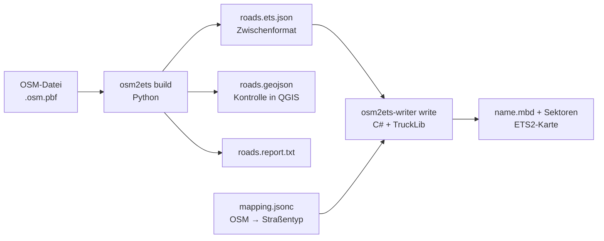

# osm2ets – OpenStreetMap → Euro Truck Simulator 2

**Deutsch** · [English](README.md)

Erzeugt aus OpenStreetMap-Daten ETS2-Kartendateien in wählbarem Maßstab (Standard 1:1)
und in fünf Detailstufen. Die gröbste Stufe enthält nur Autobahnen und Kraftfahrstraßen
mit ihren Rampen, dazu kurze Verbindungsstücke, Notfallbuchten und die Zufahrten zu
nahen Industrie- und Gewerbegebieten.



## Stand (Oktober 2026) – bitte zuerst lesen

Frühe Entwicklungsversion. Getestet im Editor von ETS2 1.61 (Linux, Proton) an einem
Ausschnitt bei Bayreuth (A 9, A 70, B 85); größere Gebiete sind ungetestet. Testkarten
v1–v46 (siehe Commits).

| Bereich | Stand |
|---|---|
| Straßennetz L1–L5 aus OSM, Maßstab 1:N, fester Ursprung | umgesetzt, getestet |
| Echte Straßenvorlagen (ger13/ger16 Autobahn, ger2 Rampe, ger1/ger5/ger9/ger29) | umgesetzt, im Spiel befahrbar |
| Durchgehende Straßen an Knoten verbunden, keine unsichtbaren Wände | umgesetzt, im Spiel geprüft |
| Autobahn-Aus-/Einfahrt mit Prefabs (2 Spuren, Rampe rechts) | umgesetzt, im Editor geprüft |
| Ebenerdige T-/X-/Gabel-Kreuzungen mit Prefabs | umgesetzt, 39 von ~46 im Testgebiet |
| Höhen aus Geländemodell, Brücken, Tunnel, `maxheight` | umgesetzt, an einer Kreuzung mit Street View abgeglichen |
| Flächiges Gelände zwischen den Straßen aus dem Geländemodell | umgesetzt, Lücken bleiben (siehe unten) |
| 3-spurige Anschlussstellen, Rampen links, Autobahnkreuze/-dreiecke | noch nicht |
| Unterführungen: offenes Gelände unter Brücken über Straßen, Steinböschungen, Brückengeländer | umgesetzt, im Spiel noch nicht geprüft |
| Brückenkörper (Überbau, Widerlager, Brüstung) für alle Brücken: SCS-Brückenmodelle je Straßentyp | umgesetzt, im Spiel noch nicht geprüft |
| Sichtstücke: Straßen höherer Stufen unter/über Brücken und unmittelbar neben der Strecke | umgesetzt, im Spiel noch nicht geprüft |
| Stufen, die aufeinander aufbauen (L1 laden, L2 dazupacken …) | geplant, noch nicht umgesetzt |
| Bewuchs/Landnutzung, Städte, Firmen | noch nicht |
| Ganz Deutschland | nicht getestet (Laufzeit, Speicher, Editor-Grenzen unbekannt) |

### Flächiges Gelände

Mit `--dem` enthält das Zwischenformat ein `terrain_grid` (10-m-Zellen, bodennah gefiltert,
bis 24 m neben einer Straße auf Straßenhöhe, bis 110 m weich ins Gelände). Der Writer füllt
den Raum zwischen den Straßen mit Terrain-Items in West-Ost-Reihen (40 m, dazu feinere Reihen
bis 1 m für Reste an Straßen). Höhenpunkte folgen dem Raster quer über jeden Streifen. Die
Freifläche berücksichtigt die echten Fahrspuren gesetzter Prefabs (Navigationskurven aus der `.ppd`).

Wie Füll- und Straßengelände zusammenpassen:
- Das Straßengelände (bis 60 m je Seite) ist neben der Straße die sichtbare Fläche: 3 m flach,
  dann weich ins Raster. Schmale Seiten bekommen einen gestauchten Verlauf, damit ihr Außenrand
  die Rasterhöhe erreicht (höchstens 45° ab dem flachen Streifen).
- Das Füllgelände liegt darunter: unter Asphalt mindestens 0,3 m, unter Straßengelände 0,1 m
  unter der tatsächlich geschriebenen Oberfläche (beide Quad-Diagonalen geprüft). Hinter dem
  Rand des Straßengeländes setzt es diesen mit höchstens 0,7 Steigung nach oben oder unten fort,
  so dass der Rand auf das Füllgelände trifft.
- Die Füllquads sind grob (bis 16 m); nach dem Setzen wird jedes Quad gegen die Fläche darüber
  geprüft und dort abgesenkt, wo es durchstoßen würde.
- Neben Prefabs (ohne eigenes Straßengelände) gilt für jede Rasterabfrage eine Böschung als
  Untergrenze: bis 5 m neben der Spurmitte auf Spurhöhe, dann mit 0,7 fallend. Liegt ein Prefab
  mindestens 3 m höher als eine Straße daneben, läuft deren Straßengelände als gerade Rampe bis an
  den Prefab-Rand (nicht im Bereich einer Unterführung). Sonst endete z. B. das Gelände neben der
  Zusammenführung vor der A-70-Brücke 3–4 m unter dem Prefab.
- Unterführungen (wie in der SCS-Karte): Unter einer Brücke, die eine Straße des Netzes (oder ein
  Prefab) mindestens 3 m höher überquert, liegt das Gelände auf Höhe der unteren Straße; von beiden
  Brückenenden fällt es als Böschung ab (1 : 1,5, steiler bei kurzer Brücke), seitlich über die
  Brückenränder hinaus als Kegel. Das ist eine Obergrenze für jede Rasterabfrage, Straßen- und
  Füllgelände folgen ihr; Dämme ebenerdiger Straßen daneben bleiben stehen. Die Böschungsquads des
  Straßengeländes bekommen das Steinmaterial der SCS-Karte (Token `175`). Brücken ohne Brückenkörper
  (siehe unten) tragen am Modellrand das Geländer `railing_01_ger` (Token `mod_ger_3`) –
  Richtungsfahrbahnen von Autobahnen nur außen (rechts) wie in der SCS-Karte, andere Straßen auf
  beiden Seiten.

Erkenntnisse aus Editor-Tests (nützlich für Weiterarbeit):
- Höhenpunkte (vertex offsets) sind **absolute** Lagen (Zeilenabstände 1,1,1,2,6,6,10,10,10,20,40,50… m),
  keine Verschiebungen. Beim Straßengelände zählen sie ab **Straßenmitte** entlang der Straße.
- `QuadData.Cols`/`Rows` zählen **Quads**; die Eckpunkte laufen 0..Cols und 0..Rows (mit der SCS-Originalkarte abgeglichen). Fehlte die letzte Spalte, entstand an jedem Stückende eine Wand.
- Höhenpunkte des Straßengeländes stehen in **Weltachsen** ab dem Anfangsknoten, Lage entlang der Hermite-Kurve des Spiels (wie in der SCS-Karte); damit funktioniert breites Straßengelände (60 m) auch in Kurven.
- Nach `Prefab.Attach` müssen die Knotendrehungen ohne Rollen neu gesetzt werden – sonst ist
  das erste Straßenstück verdreht und sein Rand klappt nach unten (Ursache der „kaputten" Ausfahrten).

### Bekannte Probleme

- Lücken (schwarz im Editor) bleiben in schmalen Zwickeln zwischen Rampe und Hauptfahrbahn
  und an manchen Prefabs; die Füllreihen laufen West-Ost und folgen schrägen Lücken nicht genau.
- Wo eine untergeordnete Straße unter einer Autobahn abgesenkt wird, fehlt noch die Einschnittsböschung.
- Brückenkörper: Jede Brücke bekommt je Straßentyp ein Brückenmodell der SCS-Karte mit Überbau,
  Widerlagern und Brüstung (`bridge_bodies` in `mapping.jsonc`; dann ohne `mod_ger_3`):
  `ger13` → `dlc_no_5` (`shared_2lanes_x_1way`), `ger16`/`ger17` → `dlc_no_4`
  (`shared_3lanes_x_1way`), jeweils links mit Versatz 0; `ger2` → `dlc_no_14` (`shared_hw_exit`)
  rechts; alle anderen bis 11 m Breite → `dlc_no_6` (`shared_simple`, damit baut auch das
  SCS-Editor-Tutorial seine Brücke). Seite und Versatz sind aus den Modellmaßen abgeleitet (die
  Brüstungen liegen dann 1,2–1,4 m außerhalb des Modellrands), im Spiel ungeprüft. Ob die
  `dlc_no_`-Modelle zum Grundspiel gehören, ist ungeprüft; gleich große Modelle des Grundspiels:
  `92`, `128`, `13`. Gerade Brücken werden ein Straßenstück; Brücken mit Kuppe oder Kurve bleiben
  mehrere Stücke – ob das Spiel dann auch an den Stückgrenzen Widerlager setzt, ist ungeprüft.
  Ohne Körper: Brücken über 200 m und Brücken, die ein Anschluss-Prefab überdeckt (siehe unten).
  Der Überbau ist 1,6 m dick; bei 5,8–6,0 m Höhenunterschied der Fahrbahnen bleiben darunter
  4,2–4,4 m. Die Widerlager stehen immer quer zur Brücke – ein Railing folgt der Straße und lässt
  sich nicht schräg stellen. Kreuzt die untere Straße schräg, rückt sie zu den Brückenkanten hin
  seitlich (halbe Körperbreite · cot α, `half_width`); der Writer verlängert die Brücke dann an den
  Enden (je Ende höchstens 15 m, davor bzw. dahinter bleiben mindestens 8 m Damm), bis die untere
  Straße an allen vier Ecken 3 m Platz bis zum Widerlager hat. Im Testgebiet L1: 9 Brücken,
  zusammen 61 m. Die flache Sohle darunter ist um denselben Versatz breiter; die Böschungen bleiben
  parallel zu den Widerlagern (werden dort aber steiler).
- Ein Körper für beide Richtungsfahrbahnen eines Brückenpaars (`bridge_body`: Railing `dlc_it_8`,
  `/model2/railing/bridge/it_hw3_lanes_2m_offset_deep_it.pmd`, **Italia-DLC**, zur Gegenfahrbahn
  hin um den halben Abstand + 2 m versetzt wie in der SCS-Karte) ist seit v89 aus: unter den
  zweispurigen Paaren der A 70 (Linien 12–15 m auseinander, das Modell ist rund 44 m breit) passte
  er nur von einer Seite. Die Zeile steht auskommentiert in `mapping.jsonc`.
- Geländerabstand (1 m außerhalb des Modellrands) und Modellbreite von `ger17` sind geschätzt.
- Sichtstücke neben der Strecke: Wo ein Feldweg oder eine Nebenstraße dicht neben der Autobahn
  deutlich höher oder tiefer liegt, stoßen die Straßengelände mit Stufen aneinander (Testgebiet L1:
  577 statt 41 Randpunkte mit mehr als 1 m Stufe, 11 statt 4 Wände). Die ärgsten Stellen (keine
  Böschung 1 : 1,5 zwischen den Rändern möglich) lässt die Pipeline aus; dort enden die Wege offen
  (Brücken samt 60 m davor und dahinter bleiben).
- Ein Weg, der in OSM als kurzer Tunnel unter einer Straße liegt (bis 80 m), wird zur offenen
  Unterführung: die obere Straße bekommt dort einen Brückenabschnitt (mit Geländer). Längere Tunnel
  bleiben Tunnel ohne Portal (die Straße verschwindet im Gelände).
- Liegt ein Bauwerk unter dem äußeren Prefab einer Anschlussstelle (Aufweitung bzw. Spurende),
  rückt dieses hinter das Bauwerk; dazwischen läuft eine Straße mit Zusatzspur (`ger17`) samt
  Brückenkörper. Liegt es unter dem inneren Prefab (Teilung bzw. Zusammenführung), rückt dieses bis
  zu 30 m vom Bauwerk weg auf die andere Seite des OSM-Knotens (Einfahrt stromauf, Ausfahrt stromab)
  – im Testgebiet die Einfahrt auf der A-70-Brücke bei x = −3270, z = −3143: 15 m. Geht das nicht
  (Bauwerk zu dicht am Knoten, auf der anderen Seite ein weiteres Bauwerk, Straßen zu kurz),
  bleibt das Prefab über dem Bauwerk: Gelände darunter offen, aber ohne Geländer und Körper.
  Endstücke der Zusatzspur-Straße bis 5,5 m zwischen Prefab und Brücke gehören zur Brücke – als
  eigene Straße stand ihr Gelände als schmale Zunge neben der Unterführung.
- Wo Straßengelände zweier deutlich verschieden hoher Straßen aneinanderstößt (dichte
  Anschlussstellen), bleiben an wenigen Stellen Stufen von 1–3 m.
- Kreuzungen ohne Prefab: Straßenstück zwischen zwei Kreuzungen zu kurz oder Winkel mehr als
  40° von T/X entfernt. Dort überlagern sich die Straßen weiterhin.
- Knotenhäufungen an Autobahndreiecken werden noch nicht als Ganzes behandelt.
- **Überlagerungsprüfung:** Nur eine Brücke oder ein Tunnel darf eine andere Fahrbahn überlagern.
  Der Writer meldet jeden Verstoß (`<input>.overlaps.geojson`).
- TruckLib berechnet keine Bounding-Boxes: im Editor immer „Map → Recompute map" ausführen.

## Voraussetzungen

- Python ≥ 3.10
- .NET 10 SDK (TruckLib 0.5.1 zielt auf .NET 10). Auf Ubuntu 24.04-basierten Systemen
  liegt `dotnet-sdk-10.0` in den Paketquellen (`sudo apt install dotnet-sdk-10.0`).
- ETS2 **1.59–1.61**: TruckLib 0.5.1 schreibt nur Kartenformat 907. Nach einem
  Spielupdate mit neuem Kartenformat braucht es eine neue TruckLib-Version.
- Optional: `osmium-tool` zum Zuschneiden großer OSM-Dateien, `rasterio` für Geländemodelle.

## Installation

```sh
python3 -m venv .venv && . .venv/bin/activate
pip install .              # oder: pip install '.[dem,test]'
dotnet build writer/Osm2Ets.Writer -c Release
```

## Ablauf

### 1. OSM-Daten holen und zuschneiden

Länder- und Bundeslanddateien gibt es z. B. bei Geofabrik (download.geofabrik.de).
Für den Anfang einen kleinen Ausschnitt nehmen:

```sh
osmium extract -b 11.48,50.02,11.62,50.06 bayern-latest.osm.pbf -o test.osm.pbf
```

### 2. Zwischenformat erzeugen

```sh
osm2ets build -i test.osm.pbf -o build/test --lod L1 \
    [--bbox minLon,minLat,maxLon,maxLat] [--dem gelaende.tif] [--scale 1] [--origin lon,lat]
```

Ergebnis: `roads.ets.json`, `roads.geojson` und `roads.report.txt`. Die GeoJSON-Datei
zeigt genau die Geometrie, die ins Spiel geht, aufgeteilt in Abschnitte gleicher
Attribute – in QGIS nach `role` einfärben (`core` = Kernnetz, `link` = Rampe,
`connector` = Anschlussstraße) oder nach `bridge`/`tunnel`. Der Bericht nennt u. a.
die größte Lageabweichung von OSM und alle höhenfreien Kreuzungen mit zu wenig Abstand.

Geländemodell: z. B. die freien Kacheln des Copernicus DEM GLO-30 (1° × 1°, GeoTIFF). Für
weitergegebene Karten ist die Namensnennung Pflicht (siehe Copernicus-Lizenz). GLO-30 ist ein
Oberflächenmodell (DSM): Wald und Gebäude heben es um mehrere Meter an, die Pipeline gleicht
das nur teilweise aus (unteres Perzentil, Glättung). Besser geeignet ist ein Geländemodell
(DGM), z. B. das bayerische DGM1 (seit 2023 frei verfügbar; Lizenz vor Verwendung prüfen).

### 3. Straßentypen festlegen

```sh
writer/Osm2Ets.Writer/bin/Release/net10.0/osm2ets-writer looks --game "<ETS2-Spielordner>" --filter ger
```

listet die Straßentypen (`road_look`) aus den `.scs`-Archiven des Spiels. Die passenden
Namen in `writer/Osm2Ets.Writer/mapping.jsonc` eintragen. Einbahn-Straßen (z. B. jede
Autobahn-Richtungsfahrbahn) werden in Fahrtrichtung geschrieben, also vom roten zum
grünen Knoten. Ob eine gewählte Vorlage diese Richtung erwartet, im Editor prüfen.

### 4. Karte schreiben

```sh
osm2ets-writer write --input build/test/roads.ets.json \
    --out "<ETS2-Benutzerordner>/mod/user_map/map" --name osm_test --verify
```

Benutzerordner laut TruckLib-Doku unter Windows `Dokumente\Euro Truck Simulator 2`;
unter Proton (Linux) im Wine-Präfix:
`steamapps/compatdata/227300/pfx/drive_c/users/steamuser/Documents/Euro Truck Simulator 2`. Der Writer legt je Sektor eine leere `.layer`-Datei an – das SCS-Wiki
nennt fünf Pflichtdateien je Sektor, TruckLib schreibt `.layer` nur bei Bedarf.

Rückgabewerte: 0 = alles geschrieben, 1 = geschrieben, aber Straßen übersprungen
(Warnungen), 3 = Prüfung mit `--verify` fehlgeschlagen, 4 = nichts geschrieben.

Schritte 2 und 4 in einem: `scripts/build_map.sh test.osm.pbf osm_test --lod L1`.

### 5. Im Editor öffnen und testen

Laut SCS-Modding-Wiki: Spiel mit dem Startparameter `-edit osm_test` starten (optional
`-noworkshop`), dann **Map → Recompute map** (TruckLib berechnet keine Bounding-Boxes),
speichern, mit **Run Map** losfahren. Alternativ im normalen Spiel über die Konsole
`preview osm_test`.

Startpunkt für Run Map: Mitte der längsten Autobahnfahrbahn, nicht auf einer Brücke.

## Detailstufen (Profil `de`)

Jede Stufe enthält die vorige. Maßgeblich ist die OSM-Klasse (`highway=*`), nicht die
Nummer im `ref`-Tag.

| Stufe | Kernnetz (mit Rampen) |
|---|---|
| L1 | motorway, trunk (+ motorway_link, trunk_link) |
| L2 | + primary (+ primary_link), meist Bundesstraßen |
| L3 | + secondary (+ secondary_link), meist Landes-/Staatsstraßen |
| L4 | + tertiary (+ tertiary_link), meist Kreisstraßen |
| L5 | + alle übrigen Wege: unclassified, residential, living_street, service (auch Parkplatzgassen, Grundstückszufahrten), road, track, path, footway, cycleway, bridleway, pedestrian |

Rampen gehören nur dazu, wenn sie das Kernnetz berühren.

Zusätzlich in jeder Stufe (`extras` und `industry` im Profil):

1. **Industrie, Gewerbe, Firmen** höchstens 300 m (Weg entlang der Straße) von einer
   Kreuzung oder Abfahrt des Netzes. Ein erreichtes Gebiet wird ganz aufgenommen, mit
   allen Straßen darin. Auf Autobahnen und Kraftfahrstraßen selbst beginnt keine
   Zufahrt, nur an Rampenenden. Eine Firma neben der Autobahn ohne nahe Ausfahrt zieht
   so keine kilometerlangen Straßen nach sich. Ziele: `landuse=industrial|commercial|
   retail|quarry|farmyard|port`, `industrial=*`, `man_made=works`,
   `building=warehouse|industrial`, `craft=*`, `office=company`.
   **Tankstellen, Rastanlagen und Lkw-Parkplätze** (`amenity=fuel`,
   `highway=services|rest_area`, `amenity=parking` mit `hgv=yes|designated`) werden
   ebenso angebunden, aber auch direkt von der Autobahnfahrbahn aus und über alle Zu- und
   Abfahrten, damit die Schleife befahrbar bleibt.
2. **Kurze Verbindungen gleicher Stufe**: ein Weg über andere Straßen, höchstens 500 m
   lang, der zwei Straßen der Stufe verbindet, z. B. das Stück Bundesstraße zwischen zwei
   Autobahnrampen in L1. Schleifen, die an beiden Enden an einer Autobahn- oder
   Kraftfahrstraßenfahrbahn hängen, sind Rastplätze und zählen immer, bis 1,5 km. Andere
   Schleifen an derselben Straße (z. B. Dorfstraßen) zählen nur, wenn der Weg über das
   Netz mindestens 1,5-mal so lang ist.
3. **Notfallbuchten** (`highway=escape`), die direkt an der Strecke liegen.
4. **Straßenenden weitergeführt**: Wo die Auswahl endet, die Straße in OSM aber
   weitergeht, werden die anschließenden Straßen 50 m (Spielmeter) mitgenommen, an
   weiteren Abzweigen nur geradeaus. Danach endet die Straße offen
   (`extras.end_extension_m`).
5. **Sichtstücke** (Rolle `visible`): Straßen höherer Stufen, die man von der Strecke aus
   sieht – damit z. B. unter einer Autobahnbrücke auch in L1 der Weg liegt, über den sie führt,
   statt eines Geländers auf ebenem Boden. Höhere Stufen setzen diese Straßen fort.
   - Kreuzt eine solche Straße eine Straße der Stufe höhenfrei (unter einer Brücke, auf einer
     Brücke darüber, durch einen Tunnel), wird sie beiderseits der Kreuzung 200 m mitgenommen
     (`extras.visible_crossing_m`), an Abzweigen nur geradeaus.
   - Abschnitte höchstens 60 m neben einer Straße der Stufe (`extras.visible_near_m`):
     Parallelwege, Abzweige an Knoten des Netzes. Lücken bis 40 m werden geschlossen,
     freistehende Reste unter 30 m entfallen, ebenso Abschnitte, die so viel höher oder tiefer
     liegen, dass keine Böschung 1 : 1,5 dazwischen passt – außer rund um eine höhenfreie
     Kreuzung (30 m längs des Wegs, bei schräger Kreuzung 30 m / sin α), an Brücken samt 60 m davor
     und dahinter und bei Lücken bis 40 m mitten in einem Stück (sonst fehlte z. B. ein 16-m-Stück
     der St 2183 neben der A-70-Brücke). Ganze Kanten bleiben auch, wenn sie kurz sind: Sie
     verbinden zwei Knoten (z. B. 6 m Feldweg zwischen Brückenende und Einmündung).
   - Klassen: alles, was L5 zeigt (`extras.visible_highway`). An Autobahnfahrbahnen enden die
     Stücke 15 m davor (keine ebenerdige Einmündung). Im Spiel: Straßentyp wie sonst, aber nicht
     auf Karte/Navi, Navi meidet; KI-Verkehr wie sonst (`visible` in `mapping.jsonc`).

In L5 kommen alle Wege dazu. Wege ohne Lkw-Verkehr bekommen im Spiel eigene Schalter
(`mapping.jsonc`):

| Weg | ETS2-Straßentyp | Schalter |
|---|---|---|
| `track` (Feld-/Waldweg) | `ger37` „ger r1 minim dirt“ | Geheimstraße, Navi meidet, kein KI-Verkehr |
| `path`, `footway`, `cycleway`, `bridleway`, `pedestrian` | `ger4` „ger road 1 minim“ | nicht auf Karte/Navi, Navi meidet, kein KI-Verkehr |
| `service` = `parking_aisle`, `driveway`, `drive-through`, `emergency_access` | `ger4` | wie Fußwege |
| alles mit `access=private`/`no` (ohne Kfz-Freigabe), z. B. Firmengelände | Typ wie sonst | zusätzlich nicht auf Karte/Navi, Navi meidet, kein KI-Verkehr (`restricted`) |

An Feld-, Fuß- und Radwegen sowie Parkplatzgassen setzt der Writer keine Kreuzungs-Prefabs.
Die Modellbreite von `ger4` und `ger37` (4,5 m) ist geschätzt, nicht vermessen. Nie dabei:
Treppen, Baustellen, geplante Straßen, Rennstrecken, Busspuren; in L1–L4 außerdem
Parkplatzgassen, Grundstückszufahrten und Wege ohne Kfz-Zugang.

Der frühere Mechanismus „Anschlussstraßen bis zur nächsten Kreuzung“
(`connectors.depth`) ist weiter im Profil einstellbar, im Profil `de` aber aus.

## Maßstab und Koordinaten

- Projektion `EPSG:25832` (ETRS89/UTM 32N), fester Ursprung = Mittelpunkt Deutschlands.
  Getrennt erzeugte Teilgebiete passen dadurch später aneinander.
- Spielachsen: x = Osten, z = Süden (Norden = −z), y = Höhe; Sektoren 4 × 4 km.
- Der Bericht nennt den größten Koordinatenbetrag und die Float32-Auflösung dort
  (Testgebiet bei Bayreuth: ~130 km vom Ursprung → ~8 mm). Ob die Engine bei mehreren
  hundert Kilometern sauber bleibt, ist ungeklärt – das ist ein Punkt für den Spieltest.
- `--scale N` skaliert die Lage, Höhen standardmäßig gleich (Steigungen bleiben).
  Brückenhöhen und Rampen gelten in Spielmetern, weil Fahrzeuge immer 1:1 sind.
  **Bei 1:19 passen Anschlussstellen geometrisch nicht mehr** (Rampen zu kurz); der
  Bericht meldet das als Kreuzungen mit zu wenig Höhenabstand. Außerdem fallen Stücke
  unter 1,25 Spielmetern weg (bei 1:19 alles unter ~24 m in echt). Für skalierte Karten
  bräuchte es eine Generalisierung, die es noch nicht gibt.

## Höhen, Brücken, Tunnel (Heuristik)

Berechnet auf einem gemeinsamen Graphen aller Straßen; an einem OSM-Knoten haben alle Straßen dieselbe Höhe.

1. Gelände entlang der Straße aus dem Geländemodell (`--dem`, GeoTIFF/VRT): bodennahes Perzentil
   (25 %), dann geglättet (120 m; Autobahn 200 m, Kraftfahrstraße 180 m, Rampen 140 m; unter
   Brücken wird überbrückt, damit die Enden nicht ins Tal gezogen werden). Steigung netzweit
   auf `terrain_max_grade` (6 %) begrenzt. Ohne Modell liegt alles auf Höhe 0.
2. Parallele Richtungsfahrbahnen von Autobahnen/Kraftfahrstraßen bis 25 m Abstand liegen gleich
   hoch (keine Stufe im Mittelstreifen).
3. Brücken ab `min_bridge_length_m` (8 m), die keine Straße des Netzes kreuzen, werden um
   `bridge_clearance_m × layer` (6,0 m) angehoben – außer Brücken von Autobahnen/Kraftfahrstraßen.
   Die Anhebung fällt mit höchstens `max_ramp_grade` (5 %) ab. Brücken über eine Straße des
   Netzes werden nur so weit angehoben, wie Schritt 5 es verlangt.
4. Jedes Bauwerk wird als Ganzes zwischen Widerlagern bzw. Portalen interpoliert.
5. Höhenfreie Kreuzungen brauchen `maxheight` (aus OSM, zuerst untere Straße, dann Brücke)
   + 1,2 m Bauwerk, sonst 6,0 m (mit Geländemodell 0,2 m Reserve für die danach angewandten
   Steigungsgrenzen). Ein Tunnel unten wird abgesenkt; eine untergeordnete Straße
   unter einer Autobahn/Kraftfahrstraße wird **abgesenkt** (die Autobahn bleibt auf Geländehöhe,
   wie in Wirklichkeit, z. B. B 85 unter A 70); sonst wird die obere Straße angehoben. Nach den
   Steigungsgrenzen wird der Lichtraum noch einmal geprüft und an der Kreuzung nachgebessert;
   Kreuzungspunkte bewegen sich dabei nur vom anderen Weg weg.

Das ist eine Näherung aus OSM-Tags, keine Vermessung.

## Zwischenformat (`osm2ets/intermediate`, Version 1)

- `roads[]`: `points` (Spielkoordinaten), `runs` (Attributabschnitte: `highway`, `role`,
  `oneway`, `lanes`, `bridge`, `tunnel`, `layer`, `ref`, `maxspeed`, `osm_ways`),
  `start`/`end` (OSM-Knoten oder `cut` am Rand).
- `junctions[]`: Knoten mit allen angrenzenden Straßenenden und deren Richtung –
  Grundlage für die geplanten Kreuzungs-Prefabs.
- `qa.low_clearance_crossings`: höhenfreie Kreuzungen mit < 4,5 m Abstand.

## Tests

```sh
python3 -m pytest                                   # 41 Tests, synthetische Netze
OSM2ETS_REAL_EXTRACT=north-bayreuth.osm.gz python3 -m pytest -k real
dotnet run --project writer/Osm2Ets.Writer.Tests    # 10 Writer-Tests: Zuordnung, Prüfung, Speichern/Laden, Verbinden
```

Als echter Ausschnitt dient die OSM-Testdatei `core/files/north-bayreuth.osm.gz`
aus dem GraphHopper-Repository (A 9, A 70, B 85).

Hinweis zu TruckLib 0.5.1: Beim Anhängen wird kein Sektor für den Mittelpunkt des neuen
Stücks angelegt, und `Map.Save` schreibt nur angelegte Sektoren. Ein Stück, dessen
Mittelpunkt in einem Sektor ohne Knoten liegt, ginge sonst beim Speichern still verloren.
Der Writer legt diese Sektoren selbst an; ein Regressionstest deckt das ab.

## Prefabs (Anschlussstellen und Kreuzungen)

Mit `--game <ETS2-Spielordner>` (oder entpackten `.ppd`-Dateien in `--prefab-dir`) setzt der
Writer SCS-Prefabs. Spieldateien werden nur gelesen, nie mitgeliefert. Einzelne Dateien lassen
sich mit `osm2ets-writer extract --game … --paths liste.txt --out …` aus den `.scs`-Archiven kopieren.

- Ausfahrt: Aufweitung 2→3 + Teilung 3→2+1; Einfahrt gespiegelt. Das zweite Prefab übernimmt
  die Richtung an der Fuge vom ersten. Gegenüberliegende Aus-/Einfahrten werden auf ≥ 19 m
  auseinandergerückt. Rampenpunkte, die näher an der Hauptfahrbahn liegen als der Rampenknoten
  des Prefabs, entfallen (sonst schwenkt die Rampe über die Hauptfahrbahn zurück).
  Straßengelände wird nur zur Zwickelseite entfernt.
- Liegt unter dem äußeren Prefab (Aufweitung bzw. Spurende) eine Brücke oder ein Tunnel, rückt es
  hinter das Bauwerk; dazwischen läuft eine Straße `ger17` ("ger hw2 ext one lane tmpl", zwei Spuren
  plus Zusatzspur) über das Bauwerk – wie in der SCS-Karte. Ein Prefab ist massiver Boden: auf einer
  Brücke über eine Straße stieg das Gelände darunter bis an die Fahrbahn. Ein Bauwerk unter dem
  inneren Prefab (Teilung/Einmündung) bleibt weiterhin überdeckt.
- Kreuzungen: T/X (`ger_r1_x_r1_*_narrow_tmpl`), vierstreifige Varianten, Gabelungen.
  Spitzwinklige Arme werden auf einen Bogen gelegt; zu nahe Kreuzungen werden Prefab an Prefab
  verbunden; Einbahn-Arme über `ChangeOrigin`.
- Knotenrollen und Richtungen kommen aus den `.ppd`-Dateien, Varianten/Looks aus den `.pmd`.

## Nächste Ausbaustufen

1. Restliche Geländelücken schließen (Zwickel, Prefab-Ränder), Einschnittsböschungen neben abgesenkten Straßen.
2. Restliche Kreuzungen: Y-Prefabs, Kreisverkehre.
3. 3-spurige Anschlussstellen, Rampen links, Autobahnkreuze.
4. Brückenmodelle, Geländematerial/Bewuchs aus OSM-Landnutzung, höher aufgelöstes DGM1.
5. Größere Gebiete: Laufzeit und Speicher für ein Bundesland oder ganz Deutschland messen.
6. Stufen, die aufeinander aufbauen: L1 herunterladen, für ein dichteres Netz L2 usw. dazupacken.
   Dafür muss L(n+1) die Straßen von L(n) unverändert übernehmen (gleiche UIDs, Höhen, Prefabs) und
   nur fortsetzen; die Sichtstücke sind der erste Schritt. Ungeprüft ist, wie das Spiel zwei
   Kartenmods mit denselben Sektordateien lädt (vermutlich ersetzt die höhere die niedrigere ganz –
   dann müsste ein L2-Paket den L1-Inhalt seiner Sektoren mitbringen).

## Lizenzen

- Python-Teil (`osm2ets/`, `tests/`, `scripts/`): GPL-3.0-or-later (`LICENSE`).
- Writer (`writer/`): GPL-2.0-or-later (`writer/LICENSE`), weil TruckLib unter
  „GPL v2" steht, ohne „or later". GPL-3.0-Code dürfte nicht mit GPL-2.0-only-Code
  zusammen verbreitet werden. Das ist eine Einschätzung, keine Rechtsberatung.
- Kartendaten: © OpenStreetMap contributors, ODbL 1.0 (openstreetmap.org/copyright).
  Eine daraus erzeugte Karte braucht diese Namensnennung. Ob eine verteilte ETS2-Karte
  als „Produced Work" oder als abgeleitete Datenbank (dann Share-Alike) gilt, ist hier
  nicht verbindlich geklärt.
