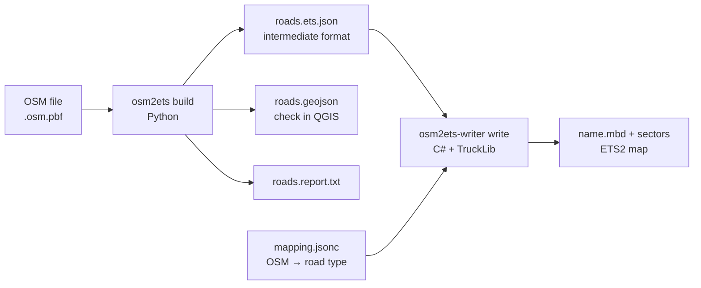

# osm2ets – OpenStreetMap → Euro Truck Simulator 2

[Deutsch](README.de.md) · **English**

Generates ETS2 map files from OpenStreetMap data at a selectable scale (default 1:1)
and in several detail levels. The coarsest level contains only the trunk road network –
in Germany motorways (Autobahnen) and federal roads (Bundesstraßen) – plus ramps and the
connecting roads up to the next junction.



## Status (October 2026) – please read first

Early development version. Tested in game with ETS2 1.61 (Linux, Proton) on an extract
near Bayreuth (A 9, A 70, B 85); larger areas have not been tested.

| Area | Status |
|---|---|
| Road network L1–L4 from OSM, scale 1:N, fixed origin | implemented, tested |
| Real road templates (ger13/ger16 motorway, ger2 ramp, ger1/ger5/ger9/ger29) | implemented, drivable in game |
| Through roads connected at nodes, no invisible walls | implemented, checked in game |
| Motorway exit/entry with prefabs (2 lanes, ramp on the right) | implemented, AI traffic uses them |
| At-grade T/X junctions with prefabs | implemented (v7), only part of the junctions, see below |
| Heights from a terrain model, bridges, tunnels | implemented (v8), not yet checked in game – see "Known issues" |
| 3-lane interchanges, left-hand ramps, motorway interchanges/triangles | not yet |
| Bridge structures (models), area-wide terrain, vegetation, cities, companies | not yet |
| All of Germany | not tested (run time, memory, editor limits unknown) |

### Area-wide terrain (v16)

With `--dem` the intermediate file also carries a `terrain_grid` (20 m, ground-filtered,
blended into road heights within 12–80 m of a road). The writer fills the space between
roads with ETS2 terrain items in west–east rows every 40 m. Each strip is flat across its
width, so on slopes small steps between rows are possible (≈0.8 m at 4 %).

### Known issues (from in-game tests)

- **Heights:** With `--dem` (e.g. Copernicus GLO-30) roads follow the terrain. Because
  Copernicus is a surface model (trees, buildings), a ground-biased percentile along the
  road is taken first and then smoothed; all roads meeting at a node share the same
  height, and the grade is limited network-wide to `terrain_max_grade` (6 %).
  Interchange prefabs are pitched accordingly, junction prefabs stay level. Terrain still
  exists only as strips beside the road (4–30 m) – beyond that there is nothing. Where
  ramps, connecting roads and junctions lie at different heights, steps and overlaps occur.
- **Junctions without a prefab** (32 of 46 in the test area): road piece between two
  nearby junctions too short, a one-way ramp starts at the side arm (TruckLib can only
  attach a road *end* to prefab node 0), or an angle more than 40° off T/X (Y shapes).
  There the roads still overlap.
- Node clusters at motorway triangles are not yet handled as a whole.
- The junction prefabs are "narrow" templates; width jumps to the road are possible.
- **Overlap check:** only a bridge or tunnel may overlap another road surface. The writer
  reports every violation (`<input>.overlaps.geojson`), cuts back branch ends without a
  prefab to the edge of the road they meet, and keeps only one through connection per node.
- TruckLib does not compute bounding boxes: always run "Map → Recompute map" in the editor.

## Requirements

- Python ≥ 3.10
- .NET 10 SDK (TruckLib 0.5.1 targets .NET 10). On Ubuntu 24.04-based systems
  `dotnet-sdk-10.0` is in the package sources (`sudo apt install dotnet-sdk-10.0`).
- ETS2 **1.59–1.61**: TruckLib 0.5.1 writes map format 907 only. After a game update
  with a new map format, a new TruckLib version is required.
- Optional: `osmium-tool` to cut large OSM files, `rasterio` for terrain models.

## Installation

```sh
python3 -m venv .venv && . .venv/bin/activate
pip install .              # or: pip install '.[dem,test]'
dotnet build writer/Osm2Ets.Writer -c Release
```

## Workflow

### 1. Get and cut OSM data

Country and state extracts are available e.g. from Geofabrik (download.geofabrik.de).
Start with a small extract:

```sh
osmium extract -b 11.48,50.02,11.62,50.06 bayern-latest.osm.pbf -o test.osm.pbf
```

### 2. Build the intermediate format

```sh
osm2ets build -i test.osm.pbf -o build/test --lod L1 \
    [--bbox minLon,minLat,maxLon,maxLat] [--dem terrain.tif] [--scale 1] [--origin lon,lat]
```

Output: `roads.ets.json`, `roads.geojson` and `roads.report.txt`. The GeoJSON file shows
exactly the geometry that goes into the game, split into runs of equal attributes –
colour it in QGIS by `role` (`core` = core network, `link` = ramp, `connector` =
connecting road) or by `bridge`/`tunnel`. Among other things the report lists the
largest positional deviation from OSM and all grade-separated crossings with too little
clearance.

Terrain model: e.g. the free Copernicus DEM GLO-30 tiles (1° × 1°, GeoTIFF). Attribution
is required for distributed maps (see the Copernicus licence).

### 3. Choose road types

```sh
writer/Osm2Ets.Writer/bin/Release/net10.0/osm2ets-writer looks --game "<ETS2 game folder>" --filter ger
```

lists the road types (`road_look`) from the game's `.scs` archives. Enter the matching
names in `writer/Osm2Ets.Writer/mapping.jsonc`. One-way roads (e.g. every motorway
carriageway) are written in driving direction, i.e. from the red to the green node.

### 4. Write the map

```sh
osm2ets-writer write --input build/test/roads.ets.json \
    --out "<ETS2 user folder>/mod/user_map/map" --name osm_test --verify \
    [--game "<ETS2 game folder>" | --prefab-dir <folder with extracted .ppd files>]
```

User folder per the TruckLib docs on Windows `Documents\Euro Truck Simulator 2`. Under
Proton (Linux) it is inside the Wine prefix:
`steamapps/compatdata/227300/pfx/drive_c/users/steamuser/Documents/Euro Truck Simulator 2`.
The writer creates an empty `.layer` file per sector – the SCS wiki lists five required
files per sector, TruckLib writes `.layer` only when needed.

Exit codes: 0 = everything written, 1 = written but roads skipped (warnings),
2 = usage/input error, 3 = `--verify` failed, 4 = nothing written.

Steps 2 and 4 in one go: `scripts/build_map.sh test.osm.pbf osm_test --lod L1`.

`osm2ets-writer info --map <map.mbd>` shows item counts and the steepest road pieces.

### 5. Open and test in the editor

Per the SCS modding wiki: start the game with the launch option `-edit osm_test`
(optionally `-noworkshop`), then **Map → Recompute map** (TruckLib does not compute
bounding boxes), save, and drive with **Run Map**. Alternatively use the console command
`preview osm_test` in the normal game.

Start point for Run Map: middle of the longest motorway carriageway, not on a bridge.

## Detail levels (profile `de`)

| Level | Core network | Connecting roads (up to the next junction) |
|---|---|---|
| L1 | motorway, trunk, federal roads (B number in `ref`), ramps | primary … living_street |
| L2 | + all primary, secondary, tertiary (state and district roads) | unclassified, residential, living_street |
| L3 | + unclassified, residential, living_street | service |
| L4 | + service (e.g. rest areas) | – |

"Junction" means a node where at least three road pieces of this level's classes meet
(core, ramps, connecting classes). Nothing else counts – no field, foot or cycle paths, no
`access=private`/`no`, no `service` ways in L1/L2, and no parking aisles or driveways in
L3/L4. The depth (`connectors.depth`) is configurable in the profile.

Federal roads are recognised by their B number, because `primary` in OSM only usually
means Bundesstraße.

## Scale and coordinates

- Projection `EPSG:25832` (ETRS89/UTM 32N), fixed origin = centre of Germany (override
  with `--origin`). Separately generated areas therefore fit together later.
- Game axes: x = east, z = south (north = −z), y = height; sectors 4 × 4 km.
- The report states the largest coordinate magnitude and the float32 resolution there
  (test area near Bayreuth: ~130 km from the origin → ~8 mm). Whether the engine stays
  clean at several hundred kilometres is unknown.
- `--scale N` scales positions; heights by default the same (grades are preserved).
  Bridge heights and ramps are in game metres, because vehicles are always 1:1.
  **At 1:19 interchanges no longer fit geometrically** (ramps too short); the report
  flags this as crossings with too little clearance. Pieces below 1.25 game metres are
  also dropped (at 1:19 everything below ~24 m in reality). Scaled maps would need a
  generalisation step that does not exist yet.

## Heights, bridges, tunnels (heuristic)

Computed on a shared graph of all roads; at an OSM node all roads have the same height.

1. Terrain along the road from the terrain model (`--dem`, GeoTIFF/VRT): ground-biased
   percentile (25 %, 60 m window), then smoothed (120 m window); grade limited
   network-wide to `terrain_max_grade` (6 %). Without a model everything is at height 0.
2. Bridges of at least `min_bridge_length_m` (8 m; shorter ones are mostly culverts) are
   raised by `bridge_clearance_m × layer` (default 6.5 m). The lift falls off along the
   network at no more than `max_ramp_grade` (5 %) – creating ramps, also across
   junctions. This also applies to bridges over rivers or railways that are not (yet)
   part of the map.
3. Each connected structure is interpolated as a whole between its abutments or portals –
   even if a ramp joins inside it. Bridge decks therefore do not sag into the valley,
   tunnels do not climb over the hill. Structure ends cut off by the extract take the
   height of their neighbour.
4. If two roads cross without a shared node with less than 6.5 m clearance: a tunnel
   below is lowered; otherwise the upper road is raised (priority: higher `layer`, then
   bridge, then current height, then ramp), at most `max_bridge_levels` levels.

This is an approximation from OSM tags, not a survey. In the test area all 10
grade-separated crossings keep at least 4.5 m clearance.

## Intermediate format (`osm2ets/intermediate`, version 1)

- `roads[]`: `points` (game coordinates), `runs` (attribute runs: `highway`, `role`,
  `oneway`, `lanes`, `bridge`, `tunnel`, `layer`, `ref`, `maxspeed`, `osm_ways`),
  `start`/`end` (OSM node or `cut` at the boundary).
- `junctions[]`: nodes with all adjoining road ends and their directions.
- `qa.low_clearance_crossings`: grade-separated crossings with < 4.5 m clearance.

## Tests

```sh
python3 -m pytest                                   # 41 tests, synthetic networks
OSM2ETS_REAL_EXTRACT=north-bayreuth.osm.gz python3 -m pytest -k real
dotnet run --project writer/Osm2Ets.Writer.Tests    # 10 writer tests: mapping, validation, save/load, connections
```

The real extract is the OSM test file `core/files/north-bayreuth.osm.gz` from the
GraphHopper repository (A 9, A 70, B 85).

Note on TruckLib 0.5.1: when appending, no sector is registered for the midpoint of the
new piece, and `Map.Save` only writes registered sectors. A piece whose midpoint lies in
a sector without nodes would otherwise be silently lost on save. The writer registers
these sectors itself; a regression test covers this.

## Prefabs (interchanges and junctions)

With `--game <ETS2 game folder>` (or extracted `.ppd` files in `--prefab-dir`) the writer
places SCS prefabs. Game files are only read, never bundled. Single files can be copied
from the `.scs` archives with `osm2ets-writer extract --game … --paths list.txt --out …`.

- Exit: widening 2→3 (`ger_hw2-hw2_exit_mirrored_tmpl_v02`) + split 3→2+1
  (`ger_hw2_exit_joint_mirrored_tmpl_v02`); entry mirrored.
- Junction areas: arms that meet at a sharp angle are bent onto an arc into the prefab direction; junctions closer than their prefab radii are connected prefab-to-prefab (the short road between them is dropped); one-way arms are attached by moving the prefab origin (`ChangeOrigin`).
- Junctions: `ger_r1_x_r1_t_narrow_tmpl` (T), `ger_r1_x_r1_narrow_tmpl` (X); for
  four-lane roads (ger29) the `ger_r2_no_offset_x_r1_narrow*` variants.
- Node roles and directions come from the `.ppd` files, variants/looks from the `.pmd`.
  The writer rotates each prefab so its arms lie as close as possible to the OSM roads,
  trims the roads and leads them straight into the prefab nodes.

## Roadmap

1. Area-wide terrain between roads (terrain items from the terrain model), pitched
   junction prefabs.
2. Remaining junctions: merge short pieces, Y prefabs, alternative T prefabs for one-way
   side arms, roundabouts.
3. 3-lane interchanges, left-hand ramps, lane changes without ramps, motorway interchanges.
4. Bridge models, terrain/vegetation from OSM land use.
5. Larger areas: measure run time and memory for a federal state or all of Germany.

## Licences

- Python part (`osm2ets/`, `tests/`, `scripts/`): GPL-3.0-or-later (`LICENSE`).
- Writer (`writer/`): GPL-2.0-or-later (`writer/LICENSE`), because TruckLib is licensed
  "GPL v2" without "or later". GPL-3.0 code may not be distributed combined with
  GPL-2.0-only code. This is an assessment, not legal advice.
- Map data: © OpenStreetMap contributors, ODbL 1.0 (openstreetmap.org/copyright). A map
  generated from it needs this attribution. Whether a distributed ETS2 map counts as a
  "Produced Work" or a derivative database (then share-alike) is not settled here.
